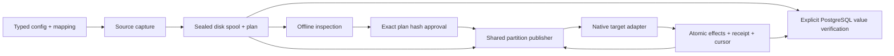

# Datamuta

[](docs/book/limits.md)
[](SECURITY.md)
[](https://github.com/copyleftdev/datamuta/actions/workflows/ci.yml)
[](#license)
[](https://copyleftdev.github.io/datamuta/)
[](#build-test-and-run)

> [!WARNING]
> Datamuta is experimental and unaudited. Do not point it at production data.
> Use disposable or fully backed-up databases, and read [limits](docs/book/limits.md)
> and the [security policy](SECURITY.md) first.

Datamuta is an **experimental Rust database migration runtime**. It captures a
typed snapshot, validates an explicit transformation, seals data into bounded
disk partitions, publishes an exactly approved plan, resumes from native commit
evidence, and verifies stored destination values. Its central design keeps
mapping semantics and recovery rules explicit while adapters implement each
database's native behavior.

This README is the repository map for people and coding agents. Read it before
planning a change. The repository contains four Rust crates, one CLI, an mdBook,
and a synthetic PostgreSQL example. All packages are `0.1.0`, with Cargo
publication disabled. There is no root Cargo workspace or hosted service.

**Read next:** [capabilities](docs/book/capabilities.md) for scope;
[example](examples/postgres/README.md) to run it;
[operations](docs/book/operations.md) to operate it;
[recovery](docs/book/recovery.md) for an interrupted job;
[limits](docs/book/limits.md) before choosing a workload.

## Capability contract

| Engine | Source capture | Publication target | Readiness in this repository |
| --- | --- | --- | --- |
| PostgreSQL | Yes | Yes | Complete documented example; restricted PostgreSQL 17 profile, still experimental. |
| MySQL | No | Yes | Laboratory loopback profile, restricted InnoDB tables. |
| MongoDB | No | Yes | Laboratory loopback replica set, restricted flat documents. |
| Firestore | Yes | Yes | Local emulator only, prescribed flat collection and identity format. |

The CLI's `configure` discovers **PostgreSQL at both ends**. Its full-value
`verify` accepts **PostgreSQL destinations**. Other adapters require explicit
configuration and native setup; they have no turnkey example here. Engine enums
express available dispatch, not qualification of every source/target combination.

The shared mapping contract supports boolean, signed `i32`/`i64`, UTF-8 and null;
complete field copies/renames; lossless `i32` → `i64` widening; and single or
composite non-null integer identities. It inserts into prepared targets rather
than merging or upserting existing application data. It preserves null versus
empty text, integer precision, and ordered identity components.

**Outside this distribution:** arbitrary schemas, nested transformations, joins,
decimals/timestamps/arrays/binary types, Parquet or other native columnar adapters,
Firebase Realtime Database, CDC, active/active synchronization, automatic
quarantine/reprocessing, cutover, rollback and distributed petabyte execution.
Two snapshot directions do not provide live bidirectional synchronization.
Resident services, hosted planning, billing and the private test gym are absent.
No hosted account, JEV request or payment integration is needed to run this CLI.

## Execution model



After successful capture, publication needs the sealed spool and destination;
the source can be offline. PostgreSQL capture blocks source writes. The Firestore
lab reader pins a read time and requires structural changes to remain quiescent.
Destination partitions become visible individually as they commit. There is no
whole-table atomic replacement or automatic application switch.

### Invariants to preserve

1. **Approve the exact job.** Engine/endpoint identities, schemas, mapping,
   implementation fingerprint and snapshot are bound into the stream plan.
   Inspection grants no authorization; `run` requires its reviewed hash.
2. **Preserve meaning and identity.** Every source and target field is assigned
   exactly once. Unsupported conversions, nullable-to-required mappings and
   changed identity ordering are refused. Type compatibility alone does not
   establish business equivalence.
3. **Commit effects with evidence.** A streaming partition's records, receipt
   and cursor commit atomically in the destination's native domain. Progress
   must describe a contiguous committed prefix.
4. **Reconcile uncertain outcomes.** Discard a failed native session, settle the
   old publisher and consult durable progress before retrying. A timeout or
   lost response does not prove rollback. Completed publication replay applies
   no new partitions when matching native evidence remains intact.
5. **Authenticate and bound data.** Sealed manifests, partition hashes and Merkle
   proofs bind spool contents. Enforce row, byte, partition and disk budgets;
   never repair corrupted evidence by recomputing hashes to make it pass.
6. **Distinguish progress from correctness.** Fast status/resume validates the
   last commit. Receipt audit checks history. Full value verification checks
   current destination data against the transformed snapshot. Neither a process
   exit nor a receipt chain replaces native value comparison.

These guarantees depend on the admitted native database behavior and trusted
receipt domain. They do not qualify arbitrary restore/rollback, malicious
metadata changes, cloud failover or production storage durability.

## Source map: where to look and change

Paths below are relative to this repository. Prefer these symbols over guessed
line numbers; read the owning implementation and its tests before editing.

| Concern | Implementation entry point | Relevant checks or reference |
| --- | --- | --- |
| CLI commands, flags, process deadline | [stream/main.rs](crates/datamuta-stream/src/main.rs): `Command`, `execute`, `main` | CLI `--help`; [operations](docs/book/operations.md) |
| Schema configuration, offline inspection, full value verification | [stream/operator.rs](crates/datamuta-stream/src/operator.rs): `configure`, `inspect`, `verify` | [PostgreSQL example](examples/postgres/README.md) |
| Engine types, configuration, plan approval, implementation identity | [stream/lib.rs](crates/datamuta-stream/src/lib.rs): `Config`, `Plan`, `SourceEngine`, `TargetEngine`, `implementation`, `capture` | [endpoint/approval tests](crates/datamuta-stream/tests/endpoints.rs) |
| Disk spool, sealing, budgets, authenticated random access | [stream/spool.rs](crates/datamuta-stream/src/spool.rs): `Limits`, `Manifest`, `Builder`, `Reader` | [corruption, bounds and restart tests](crates/datamuta-stream/tests/spool.rs) |
| Shared streaming publication, progress, resume, receipt audit | [stream/publisher.rs](crates/datamuta-stream/src/publisher.rs): `Destination`, `run`, `status`, `audit`, `check_cursor` | [recovery contract](docs/book/recovery.md); native example for database effects |
| Native streaming adapters | [postgres.rs](crates/datamuta-stream/src/postgres.rs), [mysql.rs](crates/datamuta-stream/src/mysql.rs), [mongo.rs](crates/datamuta-stream/src/mongo.rs), [firestore.rs](crates/datamuta-stream/src/firestore.rs): per-engine `Destination`; source adapters also implement `capture` | [adapter qualification](docs/book/capabilities.md#adding-an-engine) |
| PostgreSQL connections, discovery and generic adapter | [postgres/connection.rs](crates/datamuta-postgres/src/connection.rs): `Endpoint`, `Verified`, `connect`; [postgres/lib.rs](crates/datamuta-postgres/src/lib.rs): `describe`, `Destination`; [admission.rs](crates/datamuta-postgres/src/admission.rs) | [connection policy](docs/book/connections.md) |
| Typed records and mapping semantics | [plan/schema.rs](crates/datamuta-plan/src/schema.rs): `Schema`, `Scalar`; [plan/mapping.rs](crates/datamuta-plan/src/mapping.rs): `Candidate`, `compile`, `CompiledMapping` | [mapping tests](crates/datamuta-plan/src/tests.rs) |
| Bounded candidate enumeration and JEV response admission | [plan/selection.rs](crates/datamuta-plan/src/selection.rs): `ChoiceSet`, `SelectionRequest`, `Decision` | [selection tests](crates/datamuta-plan/src/selection_tests.rs); no provider transport here |
| Generic units, descriptors, bounded plans and execution | [kernel/lib.rs](crates/datamuta-kernel/src/lib.rs): `MigrationUnit`; [kernel/plan.rs](crates/datamuta-kernel/src/plan.rs): `MigrationPlan`, `TargetDescriptor`; [kernel/execute.rs](crates/datamuta-kernel/src/execute.rs): `Target<U>`, `execute` | [kernel tests](crates/datamuta-kernel/src/tests.rs) |
| Executable sample and documentation | [examples/postgres/](examples/postgres/README.md); [book summary](docs/book/SUMMARY.md); [book.toml](book.toml) | Docker example; `mdbook build` |

### Two executors, two metadata contracts

`datamuta-kernel::execute` operates on a **bounded materialized snapshot** through
the generic `Target<U>` trait. It verifies the skipped receipt prefix on resume;
effects and receipts commit together, and checkpoint advancement is a separate
step. `datamuta-postgres::Destination` implements this generic adapter contract.

The CLI uses **`datamuta-stream::publisher`**, whose native adapters atomically
commit effects, receipt and cursor for each disk-backed partition. Fast resume
checks the last commit rather than scanning the completed prefix. Its PostgreSQL
metadata is `stream_receipts` / `stream_cursor`, not the generic adapter's
`receipts` / `progress`. Do not substitute one executor, adapter or metadata domain
for the other. The streaming runtime reuses kernel primitives; it does not call
the generic executor as its partition loop.

### JEV's current role

`datamuta-plan` can enumerate a bounded complete set of structurally valid
mappings, construct a JEV selection request and admit a supplied response or
require review. It does not call the provider. The CLI accepts an explicit
mapping; it does not perform autonomous semantic discovery. Hosted selection and
agent orchestration cannot be inferred from the presence of these library types.

## Build, test and run

Use Rust **1.99 or newer** and a Unix environment: the spool implementation uses
Unix filesystem permissions. Each crate has its own `Cargo.toml`, `[workspace]`
and checked-in `Cargo.lock`. Run commands below from the repository root with
explicit manifest paths; a root `cargo test --workspace` will not work.

```sh
cargo build --release --locked --manifest-path crates/datamuta-stream/Cargo.toml

# Install a stable local command path for the documented example.
cargo install --locked --path crates/datamuta-stream --root .local/datamuta
export PATH="$PWD/.local/datamuta/bin:$PATH"
datamuta-stream --help
```

An ordinary build writes to `crates/datamuta-stream/target/` unless
`CARGO_TARGET_DIR` overrides it. The install command above uses `.local/datamuta`.

For Rust changes, select the affected crates and their dependents. This loop
checks all four independent workspaces without requiring live databases:

```sh
(
  set -e
  for crate in kernel plan postgres stream; do
    manifest="crates/datamuta-$crate/Cargo.toml"
    cargo fmt --manifest-path "$manifest" -- --check
    cargo test --locked --manifest-path "$manifest"
    cargo clippy --locked --manifest-path "$manifest" --all-targets -- -D warnings
  done
)
```

Unit/conformance tests are not native database qualification. For the runnable
end-to-end path, follow the [PostgreSQL example](examples/postgres/README.md).
It requires Docker Compose and free loopback ports 55432/55433, uses invented data,
and expects three verified rows and twelve verified fields. Review the inspected
plan hash before `run`; keep the distinction between inspection and approval.

Build the documentation with mdBook **0.5.2**:

```sh
cargo install mdbook --version 0.5.2 --locked  # Once, if absent.
mdbook build
mdbook serve --hostname 127.0.0.1 --port 3010
```

Book output is `.local/book/`; no private archive or custom preprocessor is needed.
For documentation-only edits, check relative links and build the book. Keep the
README source map, capability table and book navigation aligned with code changes.

## Change and recovery rules for coding agents

- **Establish scope from code.** Follow the source map and current tests. Treat
  capability enums, descriptors and design goals as declarations, not evidence
  of production support. Record any discrepancy between code and documentation.
- **Preserve plan compatibility deliberately.** Inspect `Plan::validate` and
  `implementation()` before changing serialization, mapping, adapters or
  dependencies. The implementation fingerprint hashes an explicit list of source
  and manifest/lockfile inputs; it is not a digest of the complete binary. Review
  that list when extending the runtime. Keep the original binary for active jobs;
  never rewrite approvals or receipts to bypass an implementation mismatch.
- **Extend the right layer.** A new CLI engine requires configuration/dispatch,
  capture and/or publication, admission, bounded encoding, identity semantics,
  native verification and an operator example. Implementing `Target<U>` alone
  does not install a streaming adapter. Use the
  [qualification criteria](docs/book/capabilities.md#adding-an-engine).
- **Keep failure behavior explicit.** Capture and full verification restart
  after interruption; publication resumes. Preserve partial evidence and use
  fresh capture/report paths. Never reset a native cursor or delete an active
  spool as a retry strategy. Read the [runbook](docs/book/recovery.md).
- **Maintain dependency and code policy.** Respect pinned dependencies, each
  crate's `deny.toml`, lockfiles, forbidden unsafe code and Clippy policy.
  A dependency change needs review; do not describe an old advisory scan as a
  current guarantee.
- **Keep private data out of changes.** Spools contain source records; logs and
  verification artifacts may also be sensitive. Keep credentials external as
  documented. Only synthetic examples belong here. Do not import experiment
  archives, private fixtures, generated evidence or hosted source to satisfy
  a missing feature or test.

## Capacity and operational boundary

The stream spool defaults to 256 MiB and admits at most 4 GiB, including index/tree
overhead; partition and record bounds also apply. The CLI has a 300-second
asynchronous deadline per command. These are admission limits, not disk
reservations, throughput promises or petabyte qualification. See
[Current limits](docs/book/limits.md) for the full contract.

Targets and native metadata must be provisioned before migration. PostgreSQL
source capture and destination verification block writes during their respective
scans. Retain the matching binary, configuration, approved plan, sealed spool and
verification evidence through the job's recovery/retention period. The operator
owns application acceptance, cutover and retirement; the CLI does not automate
those decisions.

## License

Licensed under either of [Apache License, Version 2.0](LICENSE-APACHE) or
[MIT license](LICENSE-MIT) at your option. Unless you explicitly state
otherwise, any contribution intentionally submitted for inclusion in this
work, as defined in the Apache-2.0 license, shall be dual licensed as above,
without any additional terms or conditions.
